

# 🎬 GassLight

**پلتفرم مدرن رزرو بلیط سینما و رویدادها؛ فیلم را انتخاب کن، صندلی دلخواهت را بردار، آنلاین پرداخت کن و همه‌ی بلیط‌هایت را یک‌جا داشته باش.**

[English](README.md) · [**فارسی**](README.fa.md)

### 🌐 [دمو زنده ← cinema.glt.dpdns.org](https://cinema.glt.dpdns.org/)

---

> 📌 **درباره‌ی این مخزن**
> این مخزن فقط یک **پیش‌نمایش عمومی** از GassLight است و تنها محصول و قابلیت‌های آن را معرفی می‌کند. کد منبع پروژه خصوصی است.

## ✨ معرفی

GassLight به کاربران اجازه می‌دهد فیلم‌ها و رویدادهای در حال نمایش را ببینند، سانس مناسب را انتخاب کنند، روی نقشه‌ی تصویری سالن صندلی بردارند و در چند ثانیه آنلاین پرداخت کنند. بعد از خرید، همه‌چیز از پنل شخصی قابل مدیریت است: بلیط‌های پیش‌رو، تاریخچه‌ی بلیط‌ها، لغو بلیط همراه با دریافت کردیت و پشتیبانی داخل سایت.

رابط کاربری **موبایل‌محور**، کاملاً **راست‌به‌چپ (فارسی)** و دارای **تم روشن و تاریک** است.

## 🧩 قابلیت‌ها

### 🏠 کشف و مرور
- **اسلایدر ویژه** با فیلم‌های در حال فروش و دکمه‌ی «خرید بلیط»
- **رویدادهای گذشته / آرشیو فیلم‌ها** به‌صورت شبکه‌ی پوستر با صفحه‌بندی و نمایش مدت‌زمان
- **۱۰ فیلم برتر** بر اساس امتیاز، به‌صورت کاروسل
- **اطلاعات سالن‌های سینما** در صفحه‌ی اصلی: نام سالن، آدرس، ظرفیت، تعداد ردیف‌ها و تعداد صندلی هر ردیف
- بخش «درباره‌ی ما»، لینک شبکه‌های اجتماعی و لینک‌های سریع در فوتر
- سوییچ تم روشن / تاریک و منوی تمام‌صفحه‌ی ساده

### 🎞️ فیلم‌ها و سانس‌ها
- کارت فیلم شامل پوستر، توضیح کوتاه، ژانرها، امتیاز، مدت‌زمان و **وضعیت فروش** واضح (مثلاً «توقف فروش»)
- صفحه‌ی جزئیات فیلم با امتیاز ستاره‌ای، خلاصه‌ی داستان، ژانر، مدت‌زمان و **انتخاب سانس**
- صفحه‌ی رزرو برای هر سانس: قیمت، سالن، آدرس، ساعت شروع، تاریخ و قوانین سینما

### 💺 انتخاب صندلی
- **نقشه‌ی تعاملی سالن** با شماره‌ی ردیف و صندلی
- راهنمای رنگی: **فعال**، **انتخاب شما**، **فروخته‌شده**
- صندلی‌های فروخته‌شده یا موقتاً در اختیار فرد دیگر قابل انتخاب نیستند؛ بنابراین **رزرو دوباره‌ی یک صندلی ممکن نیست**
- خلاصه‌ی سفارش به‌صورت زنده: تعداد صندلی، کد صندلی‌های انتخاب‌شده (مثل `R2-S3`) و **قیمت کل**

### 💳 پرداخت آنلاین
- انتقال امن به درگاه پرداخت آنلاین (زرین‌پال)
- صفحه‌ی پرداخت موفق با **کد پیگیری**، مبلغ پرداخت‌شده و لیست بلیط‌های خریداری‌شده
- امکان پرداخت با **کردیت** در صورت داشتن آن

### 🎫 بلیط‌های من
- سه تب: **در انتظار شروع**، **بلیط‌های گذشته**، **کنسلی‌ها**
- نمایش **شمارش معکوس** تا زمان شروع سانس برای بلیط‌های پیش‌رو
- **پرینت بلیط** و **کنسل کردن** مستقیم از همان لیست
- با کنسل کردن بلیط **کردیت** دریافت می‌کنی که در خرید بعدی قابل استفاده است

### 👤 حساب کاربری
- **داشبورد** شامل موجودی کردیت، تعداد بلیط‌های پرداخت‌شده، تعداد پیام‌های پشتیبانی، عمر اکانت و بلیط‌های اخیر
- **صفحه‌ی پروفایل** با نشان تأیید حساب، ویرایش نام کاربری، شماره تلفن و رمز عبور
- **ثبت‌نام** با نام، نام خانوادگی، ایمیل و (اختیاری) شماره تلفن و آیدی تلگرام
- **تأیید ایمیل**؛ فعال‌سازی حساب از طریق لینکی که به ایمیل ارسال می‌شود
- **فراموشی و بازنشانی رمز عبور** از طریق ایمیل
- ایمیل‌های HTML با طراحی اختصاصی

### 🛟 پشتیبانی
- **تیکت پشتیبانی** داخل سایت: موضوع و پیام را بفرست، وضعیت (*Open* / *Answered*) را دنبال کن و پاسخ را در تاریخچه بخوان

### 🛠️ برای مدیران
- پنل مدیریت برای فیلم‌ها و ژانرها، سینماها و سالن‌ها (نقشه‌ی صندلی‌ها بر اساس تعداد ردیف و صندلی سالن ساخته می‌شود)، سانس‌ها (قیمت، فعال/غیرفعال، قوانین سینما)، رزروها، پرداخت‌ها، کاربران، پاسخ به تیکت‌ها و تنظیمات کلی سایت مثل نام، لوگو، متن درباره‌ی ما و شبکه‌های اجتماعی

## 📸 تصاویر

### صفحه‌ی اصلی و منو
<table>
  <tr>
    <td align="center">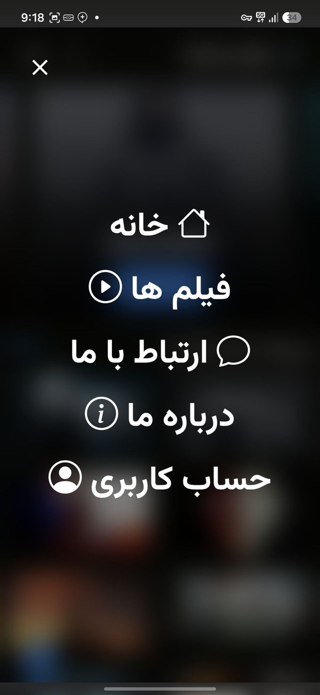 منوی ناوبری</td>
    <td align="center">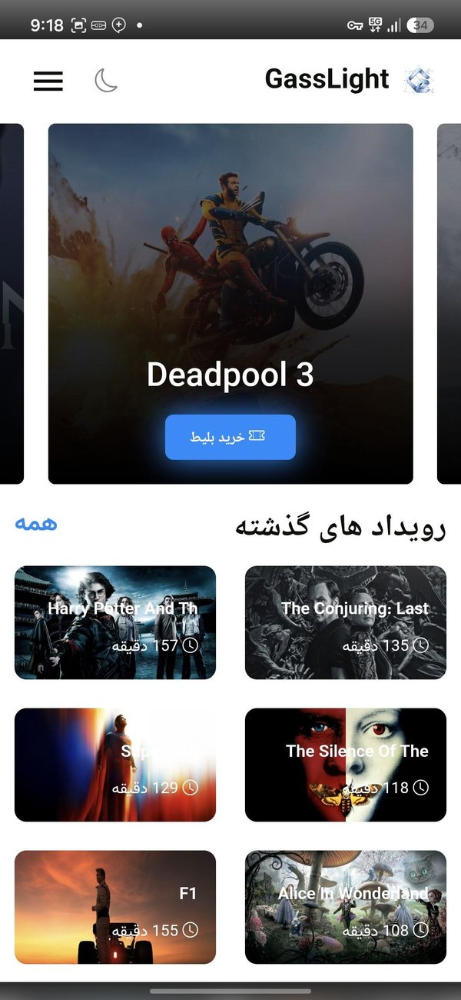 تم روشن</td>
    <td align="center">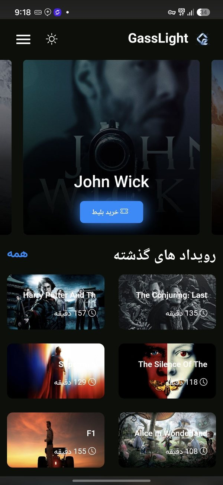 فیلم‌های ویژه و آرشیو</td>
  </tr>
</table>

  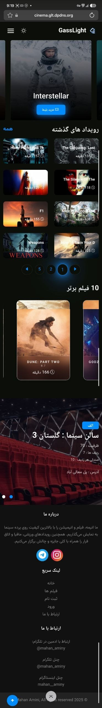 
  نمای کامل صفحه‌ی اصلی؛ صفحه‌بندی آرشیو، ۱۰ فیلم برتر، اطلاعات سالن و فوتر

### فیلم‌ها و سانس‌ها
<table>
  <tr>
    <td align="center">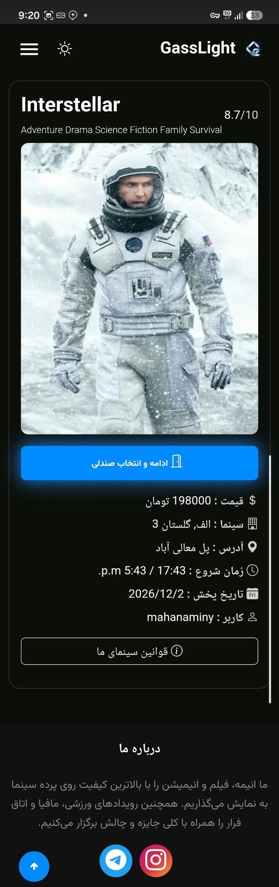 صفحه‌ی رزرو سانس</td>
    <td align="center">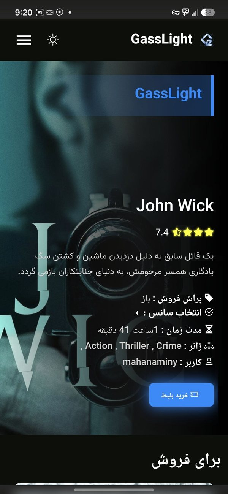 جزئیات فیلم</td>
    <td align="center">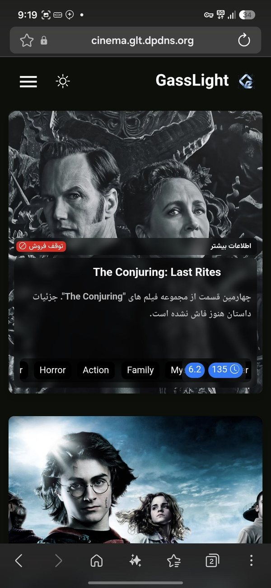 لیست فیلم‌ها</td>
  </tr>
</table>

### صندلی و پرداخت
<table>
  <tr>
    <td align="center">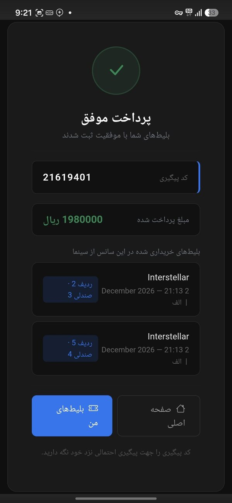 پرداخت موفق</td>
    <td align="center">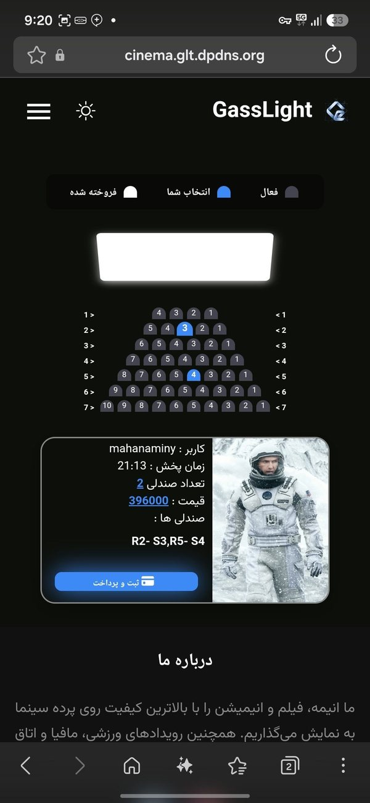 انتخاب صندلی با خلاصه‌ی زنده</td>
  </tr>
</table>

### بلیط‌های من
<table>
  <tr>
    <td align="center">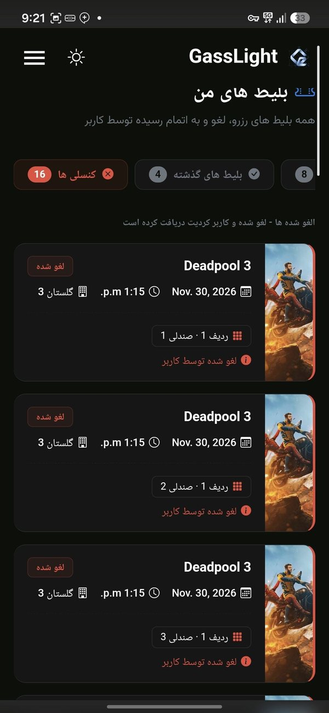 کنسلی‌ها (بازگشت کردیت)</td>
    <td align="center">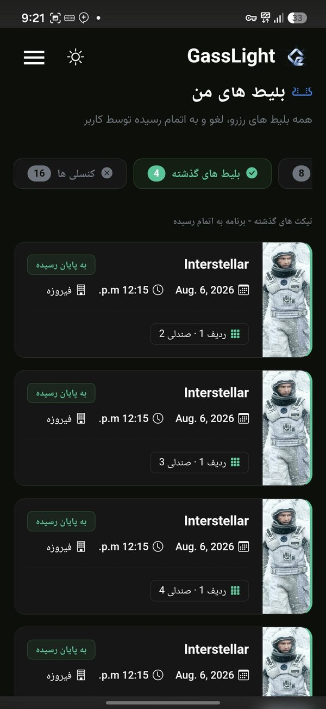 بلیط‌های گذشته</td>
    <td align="center">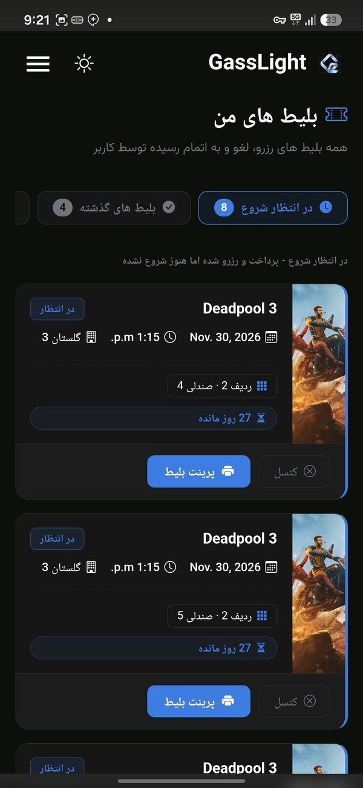 در انتظار شروع؛ پرینت یا کنسل</td>
  </tr>
</table>

### حساب کاربری و پشتیبانی
<table>
  <tr>
    <td align="center">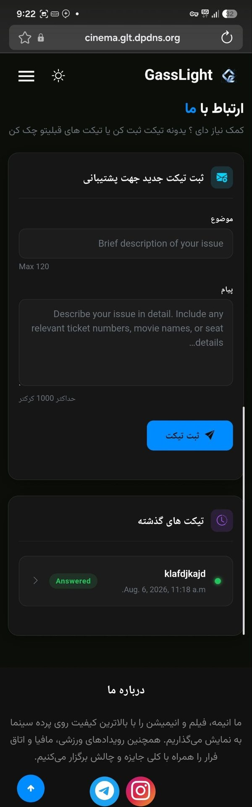 تیکت‌های پشتیبانی</td>
    <td align="center">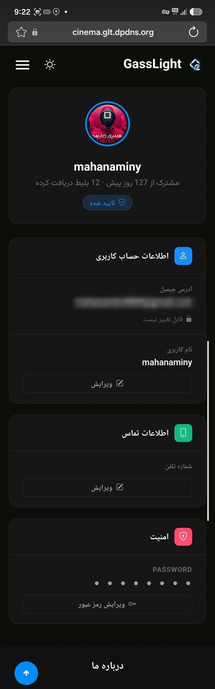 تنظیمات پروفایل</td>
    <td align="center">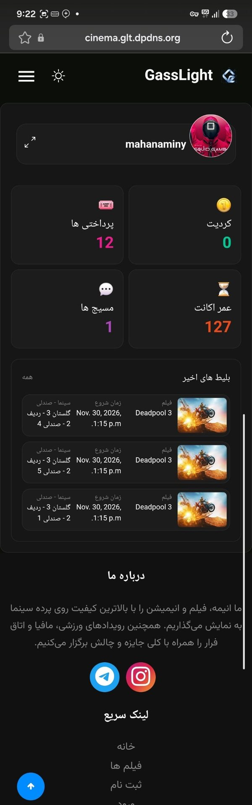 داشبورد</td>
  </tr>
</table>

### تأیید ایمیل

  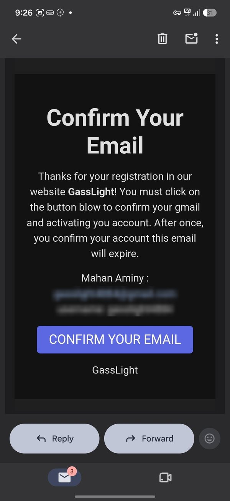 
  ایمیل تأیید حساب

## 🚀 امتحانش کن

👈 **[cinema.glt.dpdns.org](https://cinema.glt.dpdns.org/)** — حساب بساز، یک فیلم انتخاب کن و کل مسیر رزرو را تجربه کن.

## 👨‍💻 سازنده

طراحی و توسعه توسط **ماهان امینی**.

---

© GassLight. تمامی حقوق محفوظ است. کد منبع خصوصی است.

