

# 🎬 GassLight

**A modern cinema & event ticket booking platform — pick a film, choose your exact seat, pay online, and keep all your tickets in one place.**

[**English**](README.md) · [فارسی](README.fa.md)

### 🌐 [Live demo → cinema.glt.dpdns.org](https://cinema.glt.dpdns.org/)

---

> 📌 **About this repository**
> This repository is a **public preview** of GassLight. It only presents the product and its features. The source code is private.

## ✨ Overview

GassLight lets people discover what is showing, pick a showtime, choose seats on a visual hall map, and pay online in a few taps. After the purchase, everything is managed from a personal account: upcoming tickets, ticket history, cancellations with credit, and a built-in support desk.

The interface is **mobile-first**, fully **right-to-left (Persian)**, and comes with a **light / dark theme**.

## 🧩 Features

### 🏠 Discovery
- **Featured slider** with the films currently on sale and a one-tap *Buy Ticket* button
- **Past events / film archive** shown as a paginated poster grid with durations
- **Top 10 films** carousel based on rating
- **Cinema hall info** on the home page: hall name, address, capacity, number of rows and seats per row
- About-us section, social links, and quick links in the footer
- Light / dark theme switch and a clean full-screen navigation menu

### 🎞️ Films & showtimes
- Film cards with poster, short description, genres, rating, duration and a clear **sales status** (e.g. *Sales stopped*)
- Film detail page with star rating, synopsis, genres, running time and a **showtime picker**
- Booking page for each showtime: price, cinema hall, address, start time, date, and the cinema's house rules

### 💺 Seat selection
- Interactive **hall map** with row and seat numbers
- Clear legend: **available**, **your selection**, **sold**
- Seats that are already sold or temporarily held by someone else can't be picked, so **double booking is prevented**
- Live order summary: number of seats, selected seat codes (e.g. `R2-S3`) and the **total price**

### 💳 Online payment
- Secure redirect to an online payment gateway (Zarinpal)
- Success page with a **tracking code**, paid amount and the list of purchased tickets
- Pay with **credit** when you have it

### 🎫 My tickets
- Three tabs: **Upcoming**, **Past**, **Cancelled**
- Upcoming tickets show a **countdown** to the showtime
- **Print your ticket** or **cancel it** right from the list
- Cancelling a ticket gives you a **credit** that can be used on a later purchase

### 👤 Account
- **Dashboard** with your credit balance, number of paid tickets, support messages, account age and recent tickets
- **Profile page** with verified-account badge, username, phone number and password management
- **Sign up** with name, email and optional phone / Telegram ID
- **Email verification** — accounts are activated through a link sent to your inbox
- **Forgot / reset password** by email
- Branded HTML emails

### 🛟 Support
- Built-in **support tickets**: send a subject and a detailed message, then follow the status (*Open* / *Answered*) and read the reply in your history

### 🛠️ For administrators
- A management panel to handle films and genres, cinemas and halls (seat maps are generated from the hall's rows and seats), showtimes (price, activation, house rules), bookings, payments, users, support replies and global site settings such as name, logo, about text and social links

## 📸 Screenshots

### Home & navigation
<table>
  <tr>
    <td align="center">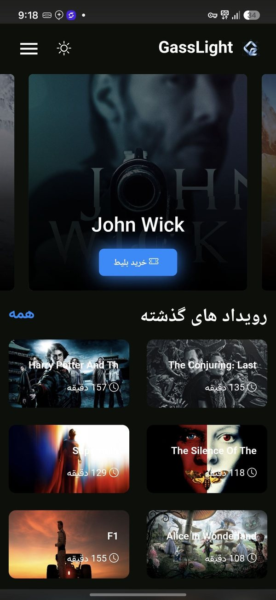 Featured films & archive</td>
    <td align="center">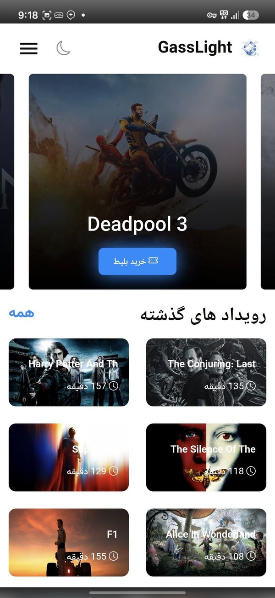 Light theme</td>
    <td align="center">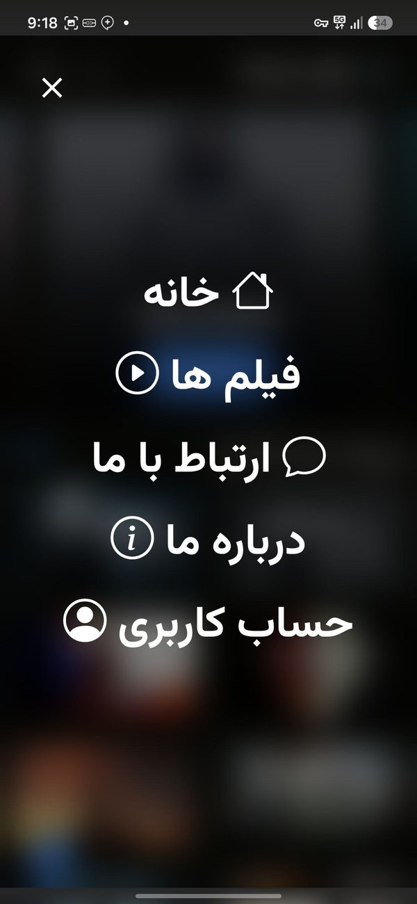 Navigation menu</td>
  </tr>
</table>

  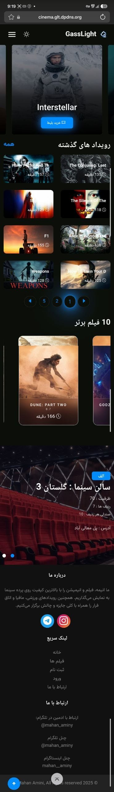 
  Full home page — archive pagination, Top 10 films, cinema hall info and footer

### Films & showtimes
<table>
  <tr>
    <td align="center">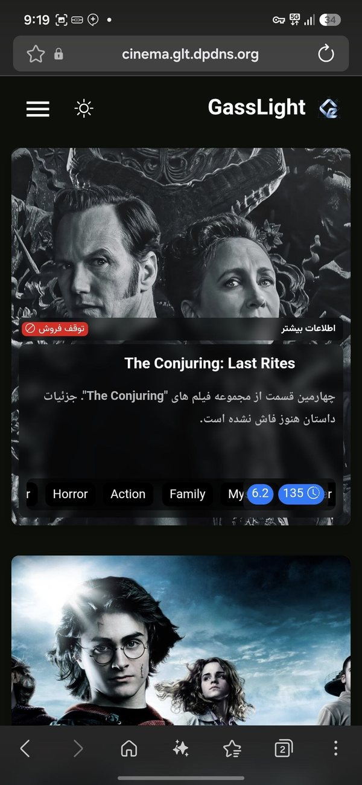 Films list</td>
    <td align="center">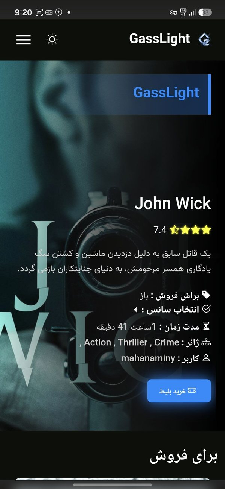 Film details</td>
    <td align="center">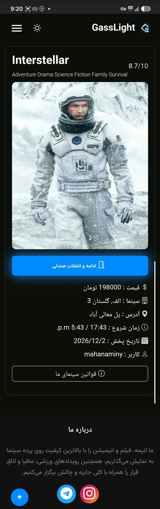 Showtime booking page</td>
  </tr>
</table>

### Seats & payment
<table>
  <tr>
    <td align="center">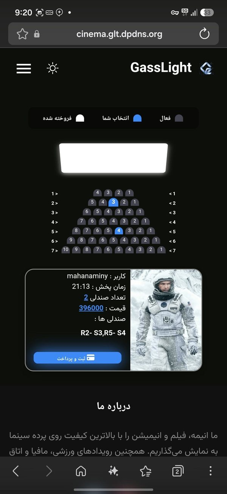 Seat selection with live summary</td>
    <td align="center">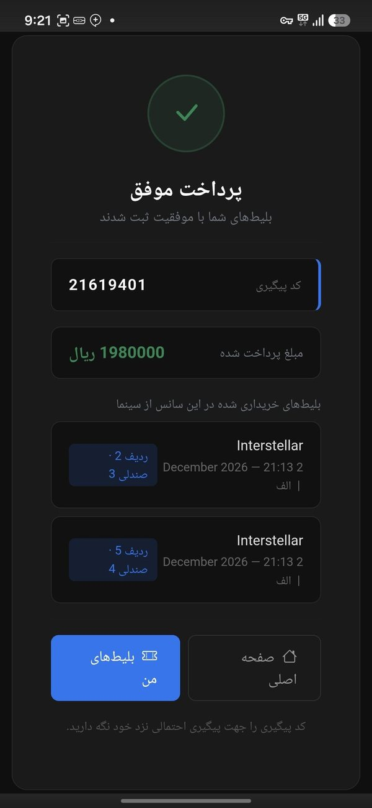 Payment success</td>
  </tr>
</table>

### My tickets
<table>
  <tr>
    <td align="center">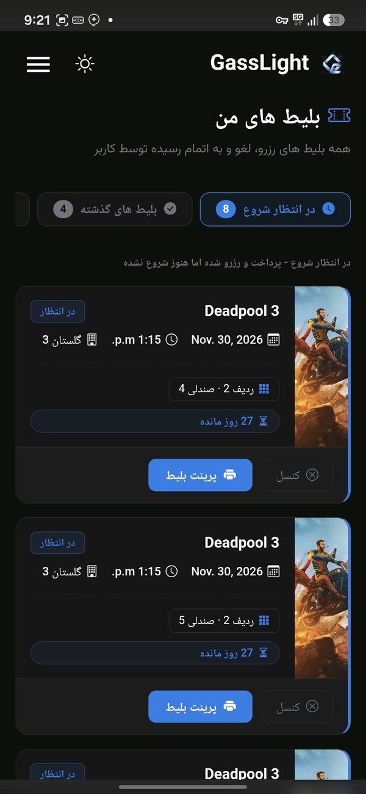 Upcoming — print or cancel</td>
    <td align="center">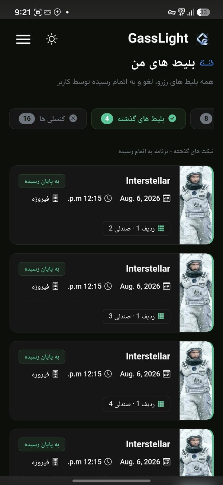 Past tickets</td>
    <td align="center">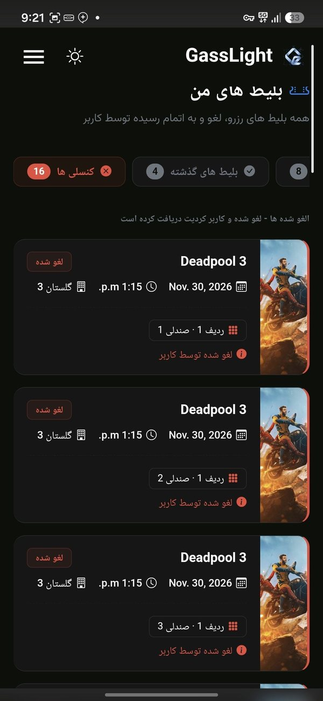 Cancelled (credit refunded)</td>
  </tr>
</table>

### Account & support
<table>
  <tr>
    <td align="center">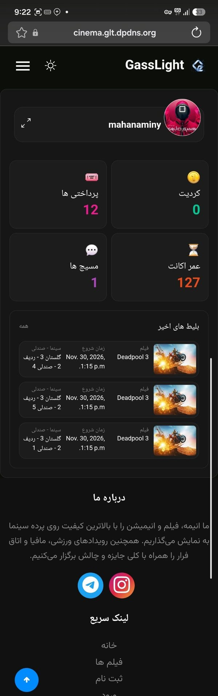 Dashboard</td>
    <td align="center">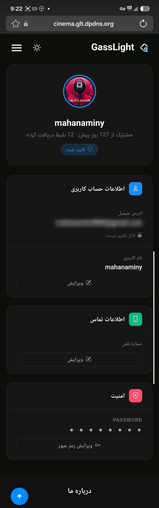 Profile settings</td>
    <td align="center">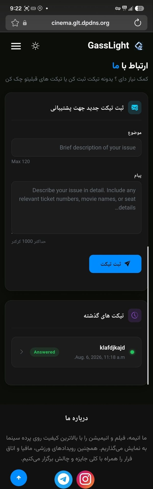 Support tickets</td>
  </tr>
</table>

### Email verification

  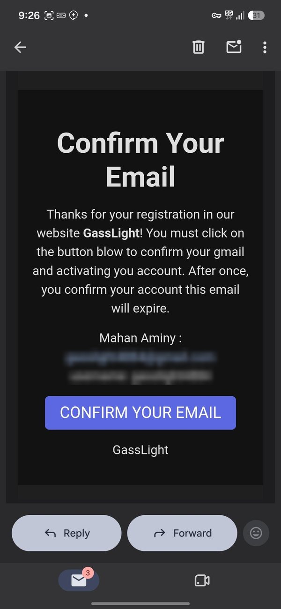 
  Account confirmation email

## 🚀 Try it

👉 **[cinema.glt.dpdns.org](https://cinema.glt.dpdns.org/)** — create an account, pick a film and walk through the full booking flow.

## 👨‍💻 Author

Designed and developed by **Mahan Amini**.

---

© GassLight. All rights reserved. Source code is private.

